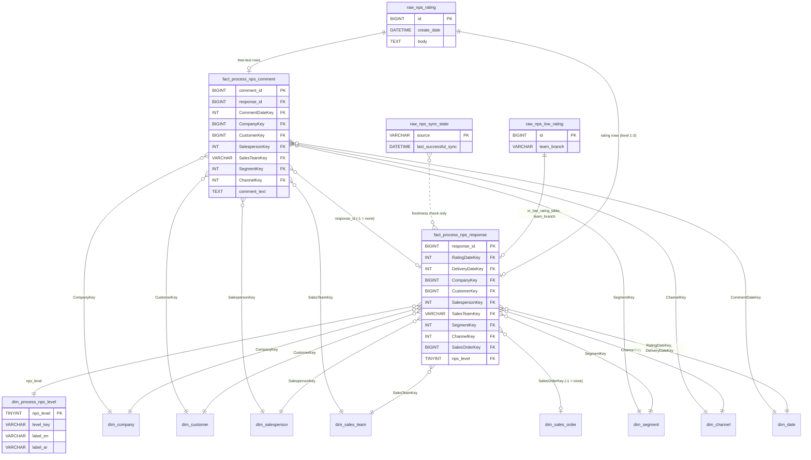

# NPS Score: warehouse schema (migration 0046)

As on branch `feature/process-nps-score` (2026-10-18). This file is the definition:
`07ps-sales-dashboard-app/data/warehouse/migrations/0046_process_nps.sql`, with the reverse script
`data/warehouse/down/0046_process_nps_down.sql`. The loader is `data/etl/src/departments/process/` (job `process_nps`);
the rules are in `docs/nps-etl.md`.

**Conventions (house rules).**
- **No foreign keys:** every fact → dimension link is enforced by an **orphan check**, and an orphan fails the run.
- **No NULL keys:** keys are never NULL in facts.
- **`-1`:** means "not resolved" and joins to the dimension's Unknown member.
- **Timestamps:** raw timestamps are **UTC**, as stored in the source. The facts carry both UTC and Africa/Tripoli
  times, and the date keys are **Tripoli** dates (yyyymmdd → `dim_date.DateKey`).

## Diagram



The other boxes (`dim_company`, `dim_customer`, `dim_salesperson`, `dim_sales_team`, `dim_segment`, `dim_channel`,
`dim_date`, `dim_sales_order`) are the existing core dimensions, owned by `core_dims` / `sales_full` and not changed by
0046.

## Tables

### raw_nps_rating
- **Grain:** one row per message in the source table `nps_rating_full_data`: a rating, a free-text comment, or a blank
  message.
- **Load:**
  - The whole table is read every run and upserted by `id`.
  - An id that is no longer in the source gets `_deleted_at` (cleared if it comes back), and the facts ignore it.
  - If the source returns 0 rows while the warehouse holds some, the run fails and nothing is marked deleted.
- **Primary key:** `id`.

| Column | Type | Null | Meaning (source) |
|---|---|---|---|
| id | BIGINT | no | Source `id` (an Odoo message id, with gaps). |
| create_date | DATETIME | yes | Source `create_date`, the moment of the rating or comment, **UTC**. |
| company_id | BIGINT | yes | Source `company_id` (FLOAT → whole number). It is the developer's **WhatsApp account**, not `res.company`, so it is **never used**. |
| company_name | VARCHAR(255) | yes | Source `company_name`: MAJAAL / TIKA. The 3rd fallback for the company. |
| created_id | BIGINT | yes | Source `created_id`, the Odoo user who posted the message (always 4, "Public user"). |
| created_name | VARCHAR(255) | yes | Source `created_name`. |
| mobile_number | VARCHAR(50) | yes | Source `mobile_number`, the customer's phone. **Personal data.** |
| delivery_code | VARCHAR(100) | yes | Source `delivery_code`: the rated document, normally the picking name (`WH/OUT/41664`), sometimes an invoice or order name. |
| body | TEXT | yes | Source `body` (HTML): one of the 3 answers, free text, or blank. **Personal data** (free text). |
| failure_type | VARCHAR(100) | yes | Source `failure_type` (always `0` so far). Not used. |
| failure_reason | VARCHAR(255) | yes | Source `failure_reason` (always `0` so far). Not used. |
| order_id | VARCHAR(50) | yes | Source `order_id`, the Odoo `sale.order` **name** (`S28061`). |
| scheduled_date | DATETIME | yes | Source `scheduled_date`, the delivery's scheduled date, **UTC**. |
| partner_id | BIGINT | yes | Source `partner_id` (FLOAT → whole number), Odoo `res.partner` id. |
| partner_name | VARCHAR(255) | yes | Source `partner_name`. **Personal data** for individuals. Not used. |
| salesperson_id | BIGINT | yes | Source `salesperson_id` (FLOAT → whole number), Odoo **`res.users`** id. |
| salesperson_name | VARCHAR(255) | yes | Source `salesperson_name`. Not used (keys never match names). |
| team_id | BIGINT | yes | Source `team_id` (FLOAT → whole number), Odoo `crm.team` id. |
| team_name | VARCHAR(255) | yes | Source `team_name`. Not used. |
| _extracted_at | DATETIME | no | When the ETL read the row (UTC). |
| _run_id | CHAR(36) | no | The ETL run that last wrote it. |
| _source_write_date | DATETIME | yes | Source `updated_at` (UTC). The same on every row, because the source is reloaded as a whole; kept for information only. |
| _deleted_at | DATETIME | yes | When the id disappeared from the source; NULL = present. |

### raw_nps_low_rating
- **Grain:** one row per message in the source table `low_rating_data`. These are the messages of deliveries rated
  "below", copied by the developer's script with the **same ids** as `raw_nps_rating`.
- **Load:** the same as `raw_nps_rating`.
- **Primary key:** `id`.

| Column | Type | Null | Meaning (source) |
|---|---|---|---|
| id … team_name | (as in `raw_nps_rating`) | | The same 19 source columns, with the same meanings. |
| team_branch | VARCHAR(255) | yes | Source `team_branch`: B2B / B2C. Copied to the fact. |
| recipient_email | VARCHAR(255) | yes | Source `recipient_email`, who the escalation e-mail goes to. **Personal data.** |
| email_notification | VARCHAR(50) | yes | Source `email_notification` (always empty so far). Not used. |
| notification_date | DATETIME | yes | Source `notification_date` (always empty so far). Not used. |
| _extracted_at, _run_id, _source_write_date, _deleted_at | | | As in `raw_nps_rating`. |

### raw_nps_sync_state
- **Grain:** one row per `source` in the source's own bookkeeping table `sync_state`, which the ETL reads and never
  writes. It is **empty** today.
- **Load:** replaced every run.
- **Primary key:** `source`.

| Column | Type | Null | Meaning (source) |
|---|---|---|---|
| source | VARCHAR(255) | no | Source `source`. |
| last_successful_sync | DATETIME | yes | Source `last_successful_sync`. Read by the warning `warn:nps_sync_state_stale`. |
| _extracted_at | DATETIME | no | When the ETL read it (UTC). |
| _run_id | CHAR(36) | no | The run that wrote it. |

### dim_process_nps_level
- **Grain:** one row per rating level (3 rows).
- **Load:** seeded by 0046, then upserted every run from `departments/process/nps.py`, which is the only definition.
- **Primary key:** `nps_level`.

| Column | Type | Null | Meaning |
|---|---|---|---|
| nps_level | TINYINT | no | 3 = exceeded, 2 = met, 1 = below. |
| level_key | VARCHAR(16) | no | `exceeded` / `met` / `below`. |
| source_text | VARCHAR(64) | no | The developer's exact answer: فاقت التوقعات / في مستوى التوقعات / أقل من المتوقع. |
| label_en | VARCHAR(64) | no | Exceeded expectations / Met expectations / Below expectations. These are our labels. |
| label_ar | VARCHAR(64) | no | The Arabic label (the same as the answer text). |
| is_low_rating | TINYINT(1) | no | 1 for level 1. |
| sort_order | SMALLINT | no | 1 exceeded, 2 met, 3 below. |
| updated_at_utc | DATETIME | no | Last upsert. |

There is no `-1` member: every response has a level by definition, because a row that is not one of the 3 answers is
not a response.

### fact_process_nps_response
- **Grain:** one row per **rating** message: one delivery's answer (level 1 / 2 / 3). Comments and blanks are not
  here.
- **Load:** rebuilt every run from the raw rows that are not deleted, with DELETE + INSERT in **one transaction**
  together with the quality checks. Readers see the old rows until the commit, and a failed check rolls everything back.
- **Primary key:** `response_id`.

| Column | Type | Null | Meaning (where it comes from) |
|---|---|---|---|
| response_id | BIGINT | no | `raw_nps_rating.id` of the rating message. |
| delivery_code | VARCHAR(100) | yes | Source `delivery_code`. |
| order_ref | VARCHAR(50) | yes | Source `order_id` text, as given. |
| rated_at_utc | DATETIME | yes | Source `create_date` (UTC). |
| rated_at_local | DATETIME | yes | `create_date` converted to **Africa/Tripoli**. |
| RatingDateKey | INT | no | **Key → `dim_date`.** The Tripoli date of `create_date`. `-1` = no `create_date` (never seen). |
| DeliveryDateKey | INT | no | **Key → `dim_date`.** The Tripoli date of the source `scheduled_date`. `-1` = no scheduled date. |
| CompanyKey | BIGINT | no | **Key → `dim_company`.** The company of the matched **sale order** (`dim_sales_order`), else of the matched **delivery** (`fact_sales_deliveries`), else the source `company_name` (MAJAAL → 1, TIKA → 3). `-1` = none of the three. |
| company_source | VARCHAR(16) | no | Which rule gave the company: `order` / `delivery` / `company_name` / `none` (computed). |
| CustomerKey | BIGINT | no | **Key → `dim_customer`.** Source `partner_id` → its commercial partner (`map_partner_customer`). `-1` = no partner, or a partner not in the map. |
| SalespersonKey | INT | no | **Key → `dim_salesperson`.** Source `salesperson_id` (Odoo user) through sheet OdooUsers (`map_odoo_user_salesperson`). `-1` = no user, or a user not in the sheet. |
| SalesTeamKey | VARCHAR(64) | no | **Key → `dim_sales_team`.** Source `team_id` through sheet OdooTeams (as transacted). With no team, or a SALESPERSON team, it is the salesperson's team. `'-1'` = neither, or an Odoo team not listed in OdooTeams. |
| SegmentKey | INT | no | **Key → `dim_segment`.** Follows the team (`dim_sales_team.SegmentKey`). `-1` = the team is unknown. |
| ChannelKey | INT | no | **Key → `dim_channel`.** Follows the salesperson (`dim_salesperson.ChannelKey`). `-1` = the salesperson is unknown or inactive. |
| SalesOrderKey | BIGINT | no | **Key → `dim_sales_order`.** The Odoo `sale.order` id matched by the `order_id` **name**; a name used in several companies is narrowed by the customer, then by the company name. `-1` = no order text, no match, or still ambiguous. `dim_sales_order` has **no `-1` row**: here `-1` is a "no match" marker, and the orphan check skips it. |
| nps_level | TINYINT | no | **Key → `dim_process_nps_level`.** From `body` by the developer's rule (`nps.classify`). |
| is_low_rating | TINYINT(1) | no | 1 when `nps_level = 1` (computed). |
| in_low_rating_table | TINYINT(1) | no | 1 when the id is also in `raw_nps_low_rating` (computed). |
| team_branch | VARCHAR(255) | yes | `raw_nps_low_rating.team_branch` (B2B / B2C). Only filled for rows of the low-rating table. |
| has_comment | TINYINT(1) | no | 1 when a comment is linked to this rating (computed). |
| loaded_at_utc | DATETIME | no | When the row was loaded. |
| _run_id | CHAR(36) | no | The run that loaded it. |

**Unknown members:** `-1` exists in `dim_company` (Unknown), `dim_customer` (Unknown), `dim_salesperson` (Unassigned),
`dim_sales_team` (`'-1'` Unknown), `dim_segment` (Unknown), `dim_channel` (Unknown) and `dim_date` (`-1`). Checked on the
local warehouse on 2026-10-18.

### fact_process_nps_comment
- **Grain:** one row per **free-text** message (a body that is not one of the 3 answers and not blank).
- **Load:** the same as `fact_process_nps_response`, in the same transaction.
- **Primary key:** `comment_id`.

| Column | Type | Null | Meaning (where it comes from) |
|---|---|---|---|
| comment_id | BIGINT | no | `raw_nps_rating.id` of the comment message. |
| response_id | BIGINT | no | **Key → `fact_process_nps_response.response_id`.** The rating of the same `delivery_code`: the latest one at or before the comment, else the first one after it. `-1` = that delivery has no rating; there is no `-1` row, and the orphan check skips it. |
| delivery_code | VARCHAR(100) | yes | Source `delivery_code`. |
| commented_at_utc | DATETIME | yes | Source `create_date` (UTC). |
| commented_at_local | DATETIME | yes | `create_date` in Africa/Tripoli. |
| CommentDateKey | INT | no | **Key → `dim_date`.** The Tripoli date of the comment. `-1` = no `create_date`. |
| CompanyKey, CustomerKey, SalespersonKey, SalesTeamKey, SegmentKey, ChannelKey | as in the response fact | no | The same rules and the same `-1` meanings, resolved from the **comment's own** source row. That row carries the same delivery, order and people as its rating. |
| comment_text | TEXT | no | Source `body` as plain text: tags removed, `<br>` → new line, phone numbers → `[phone]`, e-mails → `[email]`, Arabic digits → Latin. **Personal free text** (masked). |
| loaded_at_utc | DATETIME | no | When the row was loaded. |
| _run_id | CHAR(36) | no | The run that loaded it. |

## Views

All of them read only the two facts and the dimensions, never the raw tables.

### v_process_nps_response
- **Purpose:** the response list with readable labels, for lists, drill-downs and the low-rating list.
- **Grain:** one row per response (as the fact).
- **Reads:** `fact_process_nps_response`, `dim_process_nps_level` (inner join), and left joins to `dim_company`,
  `dim_customer`, `dim_salesperson`, `dim_sales_team` and `dim_segment`.
- **Columns:**
  - `response_id`, `delivery_code`, `order_ref`, `rated_at_utc`, `rated_at_local`, `RatingDateKey`, `rating_date`
    (= `DATE(rated_at_local)`), `DeliveryDateKey`, `delivery_date` (NULL when −1).
  - `CompanyKey`, `company`, `company_source`, `CustomerKey`, `customer`, `SalespersonKey`, `salesperson`,
    `SalesTeamKey`, `sales_team`, `SegmentKey`, `segment`, `ChannelKey`, `SalesOrderKey`.
  - `nps_level`, `level_key`, `label_en`, `label_ar`, `is_exceeded`, `is_met`, `is_below` (0/1 each).
  - `is_low_rating`, `in_low_rating_table`, `team_branch`, `has_comment`.
- No NPS-style column.

### v_process_nps_summary
- **Purpose:** counts for KPIs and breakdowns with any of the filters (date, company, branch, salesperson, customer
  group, channel, customer).
- **Grain:** one row per `RatingDateKey` × `CompanyKey` × `SalesTeamKey` × `SalespersonKey` × `SegmentKey` × `ChannelKey`
  × `CustomerKey`.
- **Reads:** `fact_process_nps_response`.
- **Columns:** the seven keys, `responses` (`COUNT(*)`), `exceeded`, `met`, `below` (`SUM(nps_level = n)`),
  `with_comment` (`SUM(has_comment)`), and `nps_style`.

### v_process_nps_trend
- **Purpose:** the monthly trend per company.
- **Grain:** one row per `rating_month` (yyyymm of the Tripoli rating date) × `CompanyKey`.
- **Reads:** `fact_process_nps_response`.
- **Columns:** `rating_month`, `CompanyKey`, `responses`, `exceeded`, `met`, `below`, `nps_style`.

### v_process_nps_comment
- **Purpose:** the comment list with labels, for roles allowed to read comments (the permission comes with step 2).
- **Grain:** one row per comment (as the fact).
- **Reads:** `fact_process_nps_comment`, with left joins to `fact_process_nps_response` (for the rating level),
  `dim_process_nps_level`, `dim_company`, `dim_customer`, `dim_salesperson` and `dim_sales_team`.
- **Columns:**
  - `comment_id`, `response_id`, `delivery_code`, `commented_at_local`, `CommentDateKey`, `comment_date`.
  - `CompanyKey`, `company`, `CustomerKey`, `customer`, `SalespersonKey`, `salesperson`, `SalesTeamKey`, `sales_team`,
    `SegmentKey`, `ChannelKey`.
  - `nps_level`, `level_key`, `label_en`, `label_ar` (NULL when the delivery has no rating).
  - `comment_text`.

### v_process_nps_low_rating (also in 0046)
`SELECT * FROM v_process_nps_response WHERE is_low_rating = 1`: the "below" responses.

### NPS-style: computed from summed counts, never averaged

**Confirmed.** Both views compute it inside each group's own `GROUP BY` from that group's counts:

```sql
ROUND(100 * (SUM(f.nps_level = 3) - SUM(f.nps_level = 1)) / COUNT(*), 1) AS nps_style
```

No view averages a score, and no table stores one.

The stored `nps_style` column of `v_process_nps_summary` and `v_process_nps_trend` is only valid for **that row**.
Anything that rolls rows up must sum `exceeded`, `met`, `below` and `responses` first, then apply the formula. Averaging
`nps_style` across rows is wrong, and the same note is in the migration header and `DATA_DICTIONARY.md`. Most summary
rows hold 1 response, so their `nps_style` is +100, 0 or −100.

## WhatsApp message reach (migrations 0049, 0050, 0051)

Source: `whatsapp_outbound_messages` in the NPS database (runbook `docs/nps-etl.md` section 8). Loaded by `process_nps`
only with `NPS_REACH_ENABLED=true`. No delivery, order or customer link: company and date only.

### raw_nps_whatsapp_message

Every source column except `updated_at`, which is kept as `_source_write_date` (source server clock, UTC+2), plus
`_extracted_at`, `_run_id`, `_deleted_at`. `id` is the key. `create_date` is UTC. **`mobile_number` stays here only.**
A row that leaves the source gets `_deleted_at` (cleared if it comes back) and keeps being counted in the fact.

### dim_process_nps_failure_group

`failure_group` (key), `label_en`, `is_fixable`, `hint`, `sort_order`, `updated_at_utc`. Upserted from
`whatsapp.FAILURE_GROUPS` on every load; seeded by 0049 and corrected by 0051:

| failure_group | label_en | fixable |
|---|---|---|
| undeliverable_131026 | 131026 Undeliverable | 0 |
| ecosystem_131049 | Meta held back (131049/130472) | 0 |
| opted_out_131050 | Customer opted out of marketing (131050) | 0 |
| template_quality | Template quality too low | 1 |
| phone_format | Phone number missing or invalid | 1 |
| meta_temporary | Meta temporary error | 0 |
| other | Other | 0 |
| - | Not an error | 0 |

### fact_process_nps_message (one row per message)

| Column | Meaning |
|---|---|
| message_id | `raw_nps_whatsapp_message.id` (key) |
| sent_at_utc / sent_at_local | `create_date` (UTC) and Africa/Tripoli |
| MessageDateKey | Tripoli date (`dim_date`), -1 none |
| CompanyKey | `company_name` MAJAAL 1, TIKA 3, else -1 (the ratings' mapping) |
| state | source state, lower case, "" when empty |
| box | delivered, read, not_delivered (state `sent`), error, other |
| failure_group | the group of an `error` message, "-" otherwise |
| template_name, is_feedback_template, is_test_number | the filters' inputs (`NPS_REACH_TEMPLATE_MATCH`, `NPS_REACH_EXCLUDED_NUMBERS`) |
| in_reach_scope | 1 = feedback template, not a test number, on or after `NPS_REACH_START` |
| deleted_in_source_at | (0051) UTC time the message left the source; still counted |

### process_nps_reach_state (0050, 0051)

One row (`singleton_id` 1): `loaded_at_utc`, `messages_loaded`, `reach_start` (0051: `NPS_REACH_START` of that load),
`_run_id`. Written in the same transaction as the fact; no row = no message load yet (the page waits).

### v_process_nps_reach / v_process_nps_message_error

Per `MessageDateKey` x `CompanyKey`, in scope only: `total_reach`, `delivered`, `not_delivered`, `read_count`,
`error_count`, `other_state`; and per date x company x `failure_group` (with label, fixable, hint, sort order): `errors`.
Messages that left the source are included.

## Personal data

| Column | Table | Layer | Notes |
|---|---|---|---|
| mobile_number (phone) | raw_nps_rating, raw_nps_low_rating | **raw only** | Not in any fact or view. |
| recipient_email (e-mail) | raw_nps_low_rating | **raw only** | Not in any fact or view. |
| mobile_number (phone) | raw_nps_whatsapp_message | **raw only** | Compared for the test-number filter; never copied. |
| failure_reason (free text) | raw_nps_whatsapp_message | **raw only** | Checks sample the leading code only. |
| body (free text; may contain phones / e-mails) | raw_nps_rating, raw_nps_low_rating | **raw** | |
| comment_text (the body of comments, masked) | fact_process_nps_comment → v_process_nps_comment | **mart + serving** | Phones and e-mails masked. Still personal free text: only roles with the comments permission (step 2) may see it. |
| partner_name, created_name, salesperson_name, team_name | raw tables | raw only | Not used by the facts. |
| customer (name) | v_process_nps_response, v_process_nps_comment | serving | Comes from `dim_customer` (the commercial partner's name), as on every sales page. For B2C individuals this is a person's name. |

## Compared with what we agreed

| Agreed | In the schema | Matches? |
|---|---|---|
| 3 levels (Exceeded / Met / Below), exact Arabic rule | `dim_process_nps_level` 3/2/1 and `fact_process_nps_response.nps_level`. Rows that are not one of the 3 answers are never responses. | **Yes** |
| Comments as a separate fact | `fact_process_nps_comment`, linked to its delivery's rating by `response_id`. | **Yes** |
| Company from the order, then company_name | Order → **delivery** → company_name → `-1`. Your answer said "the matched sale order **or delivery**", so the delivery step is there; 1 of 133 responses uses it. The source `company_id` is never used. | **Yes, with the delivery step in between** |
| create_date in Tripoli time | `rated_at_local` and `RatingDateKey` are Tripoli; `rated_at_utc` is kept next to them. Raw stays UTC. | **Yes** |

Other points to know (none of them changes an agreed rule):
1. **Loading:** the facts are reloaded with DELETE + INSERT in one transaction, not a table swap. The result for readers
   is the same at this size (tens to hundreds of rows).
2. **Extra objects** beyond your list: `raw_nps_sync_state` (freshness) and the view `v_process_nps_low_rating`.
3. **Trend scope:** `v_process_nps_trend` is per month and **company only**. A trend filtered by branch, salesperson or
   customer group must be built from `v_process_nps_summary` (or the fact), as the parked step 2 API does.
4. **`-1` with no dimension row:** `SalesOrderKey` and `fact_process_nps_comment.response_id` use `-1` as a "no match"
   marker; there is no `-1` row behind them, and the orphan checks skip `-1` for those two columns. Every other key's
   `-1` joins to an Unknown row.
5. **Redundant columns, kept for readability:** `is_low_rating` is the same as `nps_level = 1`, and `team_branch` is
   only filled for rows of the low-rating table.
6. **No channel label:** the views carry `ChannelKey` without a channel name (there is no `dim_channel` join).
7. **Raw only, not used:** `failure_type`, `failure_reason`, `email_notification` and `notification_date` are in raw
   only (always `0` or empty in the source today).
